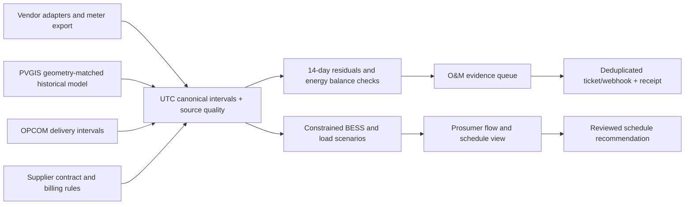

# Challenge 1 — One Energy View: Saturday battleplan

**Locked challenge:** one view of the energy a prosumer produces, consumes and stores. **Recommended first wedge:** a mixed-brand O&M exception queue, with a prosumer view of flows and tariff-aware opportunities. This is a hypothesis to test today, not an established buyer preference. Prepared 24 October 2026; times are Europe/Bucharest. Shift the relative four-hour schedule if 10:35 has passed.

**Immediate deliverables:** [energy_data_pipeline.py](energy_data_pipeline.py), [illustrative contract config](data/energy-research/contract.example.json), [ten exact local winner records](data/energy-research/winner-evidence.json), [archive and cleanup record](data/energy-research/cleanup-manifest.json). The script has no third-party dependencies. Start with `python3 energy_data_pipeline.py`; use `--synthetic-baseline` only when explicitly demonstrating an offline fixture.

**Three corrections that keep the demonstration defensible:**

- Law 160/2026 does **not** mean quantitative compensation up to 400 kW. The legal text distinguishes compensation at **≤200 kW** from financial settlement in the **200–400 kW** band; export in the latter uses the month's weighted-average PZU, not each hour's spot price. Exactly 200 kW is routed to the ≤200 scenario in our code; verify the site's applicable contract/methodology before billing. [Official law](https://legislatie.just.ro/Public/DetaliiDocument/312476)
- A live request to PVGIS `seriescalc` retrieves a **historical modeled series**, not current weather or a next-day production forecast. Do not label a historical June replay “today's measured Bucharest performance.” [JRC hourly-series documentation](https://joint-research-centre.ec.europa.eu/photovoltaic-geographical-information-system-pvgis/using-pvgis-5/pvgis-5-tools/hourly-radiation_en)
- Exact realized RON loss requires actual telemetry, the applicable contract and billing ledger, legitimate credits/taxes, and a defensible counterfactual. Our sample computes **scenario estimates** with declared assumptions. Decimal arithmetic does not make uncertain inputs exact.

## 1. Mining our scraped winners for transferable architectures

### What was searched and how to read the evidence

**After folder cleanup:** the general catalogs, scraper outputs and duplicate drafts are recoverable in the ZIP under `.archive/`. Historical source paths below identify those archived records. The ten relevant full records remain active in [winner-evidence.json](data/energy-research/winner-evidence.json), with a focused [winner index](data/energy-research/WINNERS.md).

Re-read the README, PLAYBOOK, batch Markdown, both preparation directories and all raw scraper JSON/Markdown outputs, including the nested `Hackaton/` mirror. The recursive search read relevant text files and inspected nested project/award records; the inventory records paths, byte counts and SHA-256 hashes. There were 198 inventoried text files at capture, including earlier task outputs and the new pipeline; binary PDF catalogs have Markdown counterparts, while screenshots/cache binaries are not project records. A keyword pass surfaced 295 distinct candidate identities before relevance/award screening. Neither that count nor a `verified.json` filename means all entries are competitive winners.

The selected ten below have an award record in the local files. They include sponsor/track awards and regional highlights; these are not promoted to overall championships. **“Why it won” is our editorial interpretation**, except where expressly attributed to published judges. Missing stacks remain missing. No private judging rationale or independent code audit is claimed. The preserved [winner evidence](data/energy-research/winner-evidence.json) carries the original record, source file and exact award fields.

### The top ten, ranked for this challenge's usefulness

#### 1. GridVeda — direct O&M match

**Event / placement:** TreeHacks 2026; Stanford Ecopreneurship — Best prototyping process. **Local:** [batches/002.md](data/energy-research/WINNERS.md), project #083; `data/curated.json`. **Links:** [submission](https://devpost.com/software/gridveda), [code recorded in catalog](https://github.com/theraven5520/gridveda).

**Original mechanism:** edge-based monitoring to flag potential powerline failures; reported Python/Jetson Nano/Nemotron/React/Node.js. **Why it won, editorial:** physical infrastructure gives the detection workflow a clear operational purpose; the exact published prize concerns prototyping process, not proven field reliability.

**Exact adaptation:** a site-health worklist across Huawei, Fronius and Deye adapters. Join AC output and smart-meter imports/exports to PVGIS's geometry-matched baseline; attach tariff valuation from OPCOM plus the actual retail contract. Retain a 14-day evidence window, prioritize sustained deviations, and create an O&M case. Adapt the operator workflow, not a claim that its grid model transfers to PV strings.

#### 2. PERWER — direct solar/IoT power-management match

**Event / placement:** Africa Deep Tech Challenge 2025; **IHS Challenge Prize – Power Management Category**. **Local:** `data/generated-batch002-devpost/verified.json`, exact name `PERWER`. **Link:** [submission](https://devpost.com/software/perwer).

**Original mechanism:** remote power monitoring, solar optimization and predictive analysis for mini-grids/cell towers; reported Arduino/C/C++/Python and web technologies. **Why it won, editorial:** it addresses an identifiable field power-management workflow with telemetry and operational decisions.

**Exact adaptation:** its gateway → normalized measurements → operational dashboard becomes our adapter layer. Huawei/Fronius/Deye payloads map to the same PV/load/battery/grid schema. Compare measurements with PVGIS, enrich with OPCOM and supplier rates, then display a fault or schedule recommendation with source timestamps. This is stronger than a chat interface explaining one energy CSV.

#### 3. OpenGrid — direct smart-meter data-access match

**Event / placement:** ETHGlobal New York 2025; **Chainlink – Connect the World with Chainlink**, plus Flow Builder Pool Prize. **Local:** `data/generated-batch002-eth/verified.json`; exact URL disambiguates identity. **Link:** [submission](https://ethglobal.com/showcase/opengrid-68swe).

**Original mechanism:** makes Con Edison smart-meter usage queryable, with external-data retrieval and cross-system distribution. The normalized local stack field is empty; the pitch explicitly mentions Chainlink Functions and multiple chains. **Why it won, editorial:** turns difficult-to-access real energy data into a usable interface.

**Exact adaptation:** replace Con Edison with an authorized Romanian meter export/local gateway, join to the three inverter vendors, then attach PVGIS expected output and OPCOM/contract context by timestamp. Keep a source registry and coverage indicator. Do not add blockchains: the useful transferable mechanism is external-data access and normalization.

#### 4. Realtrack — IoT provenance and event history

**Event / placement:** ETHGlobal Buenos Aires 2025; **EVVM – Your custom Service or EVVM Chain, 3rd place**, plus other named sponsor awards retained in the evidence JSON. **Local:** `data/generated-batch002-eth/verified.json`. **Link:** [submission](https://ethglobal.com/showcase/realtrack-f4kyd).

**Original mechanism:** cold-chain sensors feed a gateway that batches temperature/humidity/RFID telemetry and retains verifiable evidence. **Why it won, editorial:** connects sensor readings to an inspectable operational record.

**Exact adaptation:** batch Huawei/Fronius/Deye and meter readings with source IDs, units, completeness and checksums. Join hourly aggregates to PVGIS and tariff records. A maintenance ticket carries the actual interval evidence and estimated kWh/RON exposure, rather than an unsupported AI diagnosis. Keep provenance locally; decentralized storage is unnecessary for Saturday.

#### 5. kassi: Autonomous Observability & Remediation Agent — strongest triage architecture

**Event / placement:** Splunk Agentic Ops Hackathon 2026; **Grand Prize**. **Local:** `data/generated-batch002-devpost/verified.json`. **Link:** [submission](https://devpost.com/software/kassi-synthetic-load-generation).

**Original mechanism:** audited state machine → load test → correlate telemetry → investigate root cause → propose/write remediation, with an execution trace; reported Burr/k6/Splunk/Theodosia. **Why it won, editorial:** makes the investigation and action sequence visible and auditable.

**Exact adaptation:** ingest → quality gate → PVGIS residual → cross-check meter, SoC and inverter alarms → estimate tariff exposure → create ticket → record outcome. Huawei/Fronius/Deye are observations, not inferred causes. OPCOM/contract valuation determines urgency. A model may draft Romanian diagnostic text; deterministic checks and technician review determine the action.

#### 6. Energy Agent AI — explained business prioritization

**Event / placement:** Google Cloud ADK Hackathon 2025; **North America regional winner**. **Local:** [batches/001.md](data/energy-research/WINNERS.md), #019; `data/curated.json`. **Link:** [submission](https://devpost.com/software/energy-agent-ai).

**Original mechanism:** energy-customer analytics → explanations → targeted operational campaigns; reported ADK/BigQuery/XGBoost/SHAP/Streamlit. **Why it won, editorial:** predictions lead to an operational next step. The local notes explicitly say its customer data is simulated and SHAP does not establish causality.

**Exact adaptation:** prioritize sites by sustained PVGIS-adjusted shortfall × contract-aware energy value, not raw alarm count. Join inverter/meter/battery observations with OPCOM and contract terms, then explain which measurements drove priority. Do not call SHAP or an LLM explanation a confirmed physical diagnosis.

#### 7. GreenOps — sustainability audit to measurable intervention

**Event / placement:** Google Cloud ADK Hackathon 2025; **Asia Pacific regional winner**. **Local:** [batches/001.md](data/energy-research/WINNERS.md), #021; `data/curated.json`. **Link:** [submission](https://devpost.com/software/greenops-gzp4aj).

**Original mechanism:** cloud-resource/sustainability audit using coordinated agents and explained opportunities. **Why it won, editorial:** a bounded operational target yields measurable artifacts.

**Exact adaptation:** replace cloud resources with PV/BESS/meter intervals, compare PVGIS expectations, and evaluate opportunities under OPCOM **and** retail terms. Present intervention cards: inspect noon limiting, review reserve SoC, move a discretionary load. Track accepted/rejected recommendations and subsequent measured outcomes. Estimated opportunities remain separate from achieved savings.

#### 8. SolarScope — site geometry and understandable solar UX

**Event / placement:** World's Largest Hackathon presented by Bolt 2025; **Regional Highlights | EMEA**. **Local:** `data/generated-batch002-devpost/verified.json`. **Link:** [submission](https://devpost.com/software/solarscope).

**Original mechanism:** remote rooftop analysis, system planning and reports using mapping/solar data; reported React/TypeScript/Google Maps/Google Solar. **Why it won, editorial:** maps geographic inputs into an accessible solar decision flow. Regional highlight is the recorded recognition, not an overall prize.

**Exact adaptation:** a site card collects Romanian coordinates, kWp, tilt, azimuth and AC rating before requesting PVGIS. Attach the site's Huawei/Fronius/Deye and meter adapter, and show tariff provenance. This prevents comparing a west-facing 6 kWp site with a south-facing generic curve. Keep roof design out of the MVP.

#### 9. EdgeFinder — price comparison and constrained opportunity ranking

**Event / placement:** ETHGlobal Buenos Aires 2025; **EVVM – Best integration using the MATE Metaprotocol, 5th place**, plus a named MATE award. **Local:** `data/generated-batch002-final/verified.json`. **Link:** [submission](https://ethglobal.com/showcase/edgefinder-vwc52).

**Original mechanism:** monitors multiple prediction-market venues, matches equivalent markets and highlights price differences; pitch reports Supabase vector search. **Why it won, editorial:** matching equivalent objects across fragmented sources makes price differences actionable.

**Exact adaptation:** match the same delivery interval across meter, inverter, PVGIS and OPCOM records, then evaluate alternative BESS/load schedules under the site's contract. Preserve SoC, power, efficiency, reserve and wear constraints. Financial-market arbitrage logic is inspiration only: a Romanian household does not automatically buy/sell at hourly PZU.

#### 10. HawkWatch — anomaly to evidence to actual alert

**Event / placement:** TreeHacks 2025; **Grand Prize / 1st place**. **Local:** [batches/001.md](data/energy-research/WINNERS.md), #001; `data/curated.json`. **Link:** [submission](https://devpost.com/software/hawkwatch).

**Original mechanism:** camera event detection → timestamped evidence → alert; reported Next.js/Gemini VLM/TensorFlow.js/Supabase/Resend. **Why it won, editorial:** judges can see the complete detection-to-action loop.

**Exact adaptation:** one PVGIS-vs-inverter divergence opens an evidence card, correlated with meter/SoC and enriched with OPCOM/contract value. Create a real team-owned O&M task or send a configured webhook; store the action receipt and suppress duplicates. Do not equate an animated notification with a delivered alert.

**Rejected shortcuts:** `WattWise AI` looks relevant, but its local awards include participation/certificate entries; it is not a top competitive winner for this shortlist. `Inference` has an ambiguous “energy agent” pitch insufficient to establish electricity relevance. Tokenized energy-credit projects do not beat the operational fit above. No hardware-vendor integration is claimed merely because a winner mentions IoT.

**Use these four mechanisms first:** PERWER's gateway/schema, GridVeda's operator queue, kassi's checked state machine, HawkWatch's evidence-to-ticket loop. SolarScope informs onboarding; the others guide prioritization and future optimization.

## 2. Rule #2 architecture — join, track and act

### Applying the complete official brief: source → winner mechanism → product behavior

**Product decision:** use one shared energy ledger to serve two views: **“Which sites need attention?” for O&M** and **“Where did my energy go, and what can I change?” for the prosumer**. Validate which view has the stronger buyer first. Start with the O&M evidence queue because it makes the cross-brand/history/action workflow easy to inspect; this remains a testable choice, not an interview finding.

The pasted brief adds useful constraints, but it does not establish that every claimed market gap or saving exists. Market counts, storage penetration, vendor shares and US loss rates are **brief-supplied context, not independently verified facts in this update**. Preserve their date/source attribution in research notes. Do not convert a utility-scale US loss percentage into expected Romanian rooftop savings. Saturday interviews must establish the actual loss and existing workaround.

| Information or source in the supplied brief | Winner mechanism from our local files | Concrete application / evidence we must obtain |
| --- | --- | --- |
| Fragmented production, consumption, storage and grid data | **PERWER + OpenGrid** | A gateway/adapter registry feeds one canonical energy ledger. Every channel has origin, timestamp, unit and access state. Demonstrate the same site ID linking inverter PV, meter flows and battery SoC; obtain one real permissioned export. |
| StoreNet: one-minute PV, load, battery, SoC and weather | **Realtrack + PERWER** | Preserve historical raw rows and provenance; aggregate to consistent intervals and check energy balance/SoC. Replay a measured household trace before adding a separately flagged fault. Do not relabel Sonnen/Irish reference data as measured Huawei/Deye/Fronius telemetry. |
| OPSD Konstanz: generation, consumption and grid flows | **OpenGrid + Realtrack** | Build a second-source normalization check. OPSD documents cumulative measurements and interpolated gaps: difference counters, inspect resets, retain quality flags. Derive household load only when the required PV/grid/storage channels exist. Do not join different houses into a purported physical site. |
| PVGIS expected hourly output for a location/system | **SolarScope + GridVeda** | Collect GPS, DC capacity, tilt, azimuth and inverter AC rating. Request a matching historical model, then use a weather-matched healthy reference to assess residuals. For Irish/German measured PV, request the actual source site's geometry/location if known; Bucharest PVGIS belongs to a labeled Romanian simulation until real local telemetry exists. |
| OPCOM PZU and changing settlement rules | **EdgeFinder + Energy Agent AI** | Match delivery intervals and attach a site-specific valuation policy. Separate hourly market observations, monthly weighted export settlement and contractual import price. Rank feasible opportunities only after selecting the actual customer's regime. |
| O&M discovers issues after money is lost | **GridVeda + kassi** | Rank persistent underperformance by evidence quality and estimated exposure, investigate alternative explanations, then open a work order. Compare alert time with a technician-confirmed discovery time; do not assert early detection from a planted anomaly. |
| Battery underuse or an incorrect schedule | **EdgeFinder + GreenOps** | Compare observed dispatch with a physically feasible alternative using equal terminal SoC, reserve intent, efficiency and wear. Show the schedule and its assumptions; ask the owner why the existing reserve/schedule was chosen. |
| API accounts, rate limits and single sessions | **PERWER's gateway + kassi's state machine** | One connector worker owns each credential/session, caches responses, queues site polls and backs off on failure. Display stale/missing data rather than interpreting a failed poll as zero production. Validate actual tenant/endpoint limits; the brief's approximate one-call/minute constraint is a planning input, not a universal constant. |
| Fronius read API; Huawei/Deye access differs | **OpenGrid + SolarScope** | Onboarding begins with an access checklist: supported model, meter presence, API enabled, installer consent, available channels. Prove one working read path before investing in three cloud connectors. Local Fronius access may also require activation. |
| Data-protection and foreign-vendor concerns | **Realtrack + kassi** | Minimize retained identity data, isolate tenants, store secrets outside evidence payloads, preserve access logs and allow revocation. Process numeric telemetry locally/server-side under the agreed boundary. A diagnostic LLM receives selected measurements and candidate evidence, not credentials, raw household identities or unrestricted device-control tools. |
| Existing apps, Home Assistant and fleet platforms | **GreenOps + HawkWatch** | Test incremental value against the customer's actual tool: can it already show PV/load/battery and alert on this fault? Measure time to a useful case, false alerts and next action. Compete on the joined, source-linked investigation workflow, not merely another chart. |

**Important competitive correction:** avoid the pitch “manufacturer apps cannot show consumption/storage/grid” or “nobody combines these sources.” Fronius already documents integrated inverter/meter data and third-party energy-management interfaces. The supplied brief itself names multi-brand fleet platforms and Home Assistant. Our narrower hypothesis is that **a specific Romanian mixed-fleet operator lacks a low-effort, contract-aware, evidence-linked triage workflow that also explains the outcome to its customer**. Test that against the actual existing setup. [Fronius API](https://www.fronius.com/en/help-center/solar-energy/products/monitoring-control/solutions/open-interfaces/fronius-solar-api-json-), [Fronius energy-management interfaces](https://www.fronius.com/~/downloads/Solar%20Energy/Solution%20Sheets/SE_SOLS_Fronius_Energy_Management_Solution_EN.pdf)

### The coherent prototype to build from these patterns

**Four screens, one ledger; build the first three before adding breadth:**

1. **Connection/coverage:** site, brand, channels available, source mode, last successful read, coverage, geometry and tariff policy. Missing hardware/access is visible. SolarScope supplies the site-setup idea; OpenGrid/PERWER supply the connector abstraction.
2. **O&M priority queue:** site, expected/actual kWh, sustained deviation, possible explanations, estimated exposure, owner and case status. GridVeda supplies the queue; Energy Agent AI supplies explained prioritization.
3. **Diagnostic case:** original measurements, baseline provenance, meter/SoC cross-checks, rule results, next checks, technician decision and actual ticket receipt. Realtrack supplies evidence lineage; kassi supplies the checked workflow; HawkWatch supplies the complete action loop.
4. **Prosumer summary:** production, load, imports/exports, SoC and a single understandable recommendation. GreenOps supplies intervention cards; EdgeFinder supplies comparison against a feasible alternative under actual tariffs. Show this view to households without assuming they want to manage an O&M console.

**AI boundary:** numeric detection, joins, billing-policy selection, optimizer constraints and ticket deduplication are deterministic. A model can summarize a checked evidence packet in Romanian and propose diagnostic questions. It must distinguish observed evidence, candidate causes and missing checks. No LLM-generated causal claim or price fills a missing sensor/contract field.

### Two demos with different evidentiary purposes

**Demo A — measured-history credibility:** use one actual StoreNet household with its documented weather/time context and all available power/battery channels. Replay its measurements and check consistency. Use OPSD as a separate adapter/reference case. A physically observed anomaly requires a known outcome or technician review; otherwise show the trace without declaring a fault. This tests ingest/normalization, not Romanian willingness to buy.

**Demo B — Romanian workflow and controlled fault:** use geometry-matched Bucharest PVGIS with a clearly simulated site. Run the Huawei-noon-cap, Deye-dispatch and Fronius-18%-shortfall scenarios already supported by the script. Each brand is a label until an actual connector supplies its measurements. Show the residual, alternative explanations, declared RON valuation and a created team-owned ticket. This tests pipeline behavior, not measured early-warning accuracy.

**Bridge the two through interviews:** ask a Romanian technician for a redacted real site trace and the last diagnosed incident. Replace one simulated site with that source; retain the original and record the actual discovery/remediation date. That becomes the first meaningful local validation case.

### First implementation tasks after reading this brief

| Priority | Work | Completion evidence |
| --- | --- | --- |
| **P0** | Qualify two O&M respondents and two installed-PV/BESS owners; investigate the same recent incident questions. | Exact quotes, actual existing tools, known pain/counterevidence, one data-access commitment. |
| **P0** | Add a real full-telemetry importer for one selected StoreNet household; preserve weather/time context. | Real rows and lineage, a valid energy balance, no assertion that brand mock labels are real devices. **Not yet implemented in the current script**, whose optional profile input uses only load shape. |
| **P0** | Retain and display source freshness/quality through the entire diagnostic case. | A stale source yields “insufficient evidence,” not a zero-production fault. |
| **P0** | Demonstrate one deduplicated work-order action on checked evidence. | Destination case ID/receipt, repeat run without duplicate, simulation status visible. |
| **P1** | Ingest a real same-period OPCOM export and the relevant supplier terms. | Observed versus illustrative values clearly separated; correct price units and settlement regime. |
| **P1** | Establish one real vendor read path, preferably existing authorized Fronius/local access or an installer-provided Huawei API/export. | Successful read, available fields, access limitations and polling policy documented. |
| **P2** | Add a forecast-based battery/load recommendation once the primary persona and tariff economics justify it. | Physically feasible schedule, explicit reserve, actual applicable tariff and a measured follow-up plan. |

The existing pipeline remains an honest historical simulation until these integrations are added. This application plan does not claim they have already been implemented.

### Four independent source contracts, plus optional contemporary weather

The prompt lists A/B/C but asks for four sources. We split C into **market observations** and **site-specific retail/billing rules**; the latter cannot be inferred from OPCOM. Battery and inverter measurements from one gateway are channels, not automatically independent sources.

| Source | Real input / adapter | Saturday implementation and truth label |
| --- | --- | --- |
| **1. Telemetry + meter** | Huawei Northbound/pyhfs, Fronius local Solar API, Deye authorized export/gateway; independent meter export when available | Default code simulates three named-brand sites. Optional real historical household load shape can be imported. No real vendor connector is claimed active. Obtain one consented Romanian export today. |
| **2. Physics baseline** | JRC PVGIS `seriescalc`, Bucharest geometry, 1 kWp then scale each site | Script makes a live no-auth request for **historical 2020** modeled output and retains raw response; explicit cache/offline options exist. |
| **3. Market** | Official OPCOM PZU results with delivery interval, RON/MWh, source date; monthly published weighted mean for financial settlement | Script accepts normalized 15-minute/hourly price CSV. Default prices are visibly synthetic. No brittle undocumented OPCOM scraping endpoint is presented as working. |
| **4. Contract + billing** | Actual supplier contract, active-energy component, import price, tax/tariff treatment, compensation regime, export ledger | Script loads JSON, defaulting to an illustrative fixed tariff. Exact monthly settlement remains a later reconciliation step. |
| **Optional 5. Same-period weather/irradiance** | Site irradiance sensor or verified historical/current weather feed with temperature and plane-of-array conversion | Required to make a claim about **current weather-adjusted** degradation. Not implemented by merely relabeling historical PVGIS data. |

**Current completion state:** runnable join of modeled baseline + simulated fleet + declared market/contract scenarios, with real-file ingestion hooks. That demonstrates computation and history, but is **not four independently live-connected sources**. Replace inputs and display source status individually before claiming the four-real-source target. One real join already exceeds the official minimum; synthetic injection proves pipeline behavior, not customer pain or production reliability.

### Dataflow and storage



Canonical row: `site_id, timestamp_utc, interval_minutes, pv_kwh, load_kwh, grid_import_kwh, grid_export_kwh, battery_charge_kwh, battery_discharge_kwh, soc_start_pct, soc_end_pct, expected_kwh, source_id, quality_flags`. Site registry adds GPS, tilt/aspect, DC kWp, AC rating, battery usable capacity, vendor model and timezone. Tariff records have effective dates, not just a floating number.

- Convert W readings to kWh with actual interval duration; do not sum watts. Distinguish interval energy from cumulative meter counters, handle resets and flag gaps.
- Canonical battery charge/discharge are positive **AC-side** flows; store capacity/SoC changes are internal-side. Explain efficiency in balance checks.
- Energy identity: `PV + grid_import + battery_discharge = load + grid_export + battery_charge`, within asynchronous sensor tolerances.
- Store UTC; render Europe/Bucharest. Tomorrow, 25 October 2026, has a clock change: local delivery days need explicit offsets and can have 25 hours. Do not hard-code 24 prices/day in a production adapter.
- OPCOM's current public page exposes **15-minute** day-ahead results. Duration-weight before hourly comparison; keep price units RON/MWh and divide by 1,000 for RON/kWh. Do not take a simple unweighted monthly mean to fabricate the official weighted settlement price. [OPCOM results and notices](https://www.opcom.ro/acasa/ro)
- Use SQLite for `sites, raw_measurements, intervals, baseline_runs, price_intervals, contracts, anomaly_events, tickets, action_receipts`. Append source snapshots; upsert normalized intervals by source/site/time. Initial JSON preserves 14 days; persistence across later ingestions is the next integration step.

### Vendor adapters: what actually exists

**Huawei:** `pyhfs` is a Northbound Interface client requiring a suitable Northbound API account; a homeowner's app login is not automatically enough. Its documented minimal call is `with pyhfs.ClientSession(user=..., password=...) as client: client.get_plant_list()`. Validate permissions and the returned schema before writing a measurement mapper; do not invent channel methods. Store credentials in environment variables, never output JSON. [Maintainer documentation](https://github.com/guillaumeblanc/pyhfs)

**Fronius:** the local read API exposes `/solar_api/v1/GetPowerFlowRealtimeData.fcgi`; check returned version/model and whether a smart meter/battery is installed. `P_Grid` can be positive import, `P_Load` negative consumption, `P_Akku` positive charging; normalize signs using the actual model's documentation and preserve nulls when hardware is missing. The local API is distinct from the cloud Solar.web Query API. [Fronius interface documentation](https://www.fronius.com/en/help-center/solar-energy/products/monitoring-control/solutions/open-interfaces/fronius-solar-api-json-)

**Deye/Solarman:** start with a consented export or an existing authorized gateway integration. Model/register maps and logger variants differ; no universal Modbus register write is safe to invent. Today, a labeled Deye mock is sufficient for schema demonstration, while one real export establishes access feasibility.

Read-only Fronius adapter starting point, once on an authorized local network:

```python
from urllib.request import urlopen
import json
# Replace host with the actual owned/authorized inverter hostname.
with urlopen('http://INVERTER-HOST/solar_api/v1/GetPowerFlowRealtimeData.fcgi', timeout=5) as r:
    raw = json.load(r)
site = raw['Body']['Data']['Site']
# Preserve missing fields; W is instantaneous power, not hourly kWh.
pv_w = site.get('P_PV')
grid_w = site.get('P_Grid')
```

This is an adapter sketch, not a completed historical telemetry connector. Do not mix its one current snapshot into a historical June baseline.

### O&M: rolling divergence and fault candidates

For each quality-qualified day, compute `residual = (expected_kwh - actual_kwh) / expected_kwh`. Suppress night/low-irradiance intervals; require coverage. Calibrate geometry and a healthy-site ratio before applying thresholds. Use the prior healthy period as calibration, then inspect rolling 3/7/14-day persistence. Suggested initial trigger: >12% shortfall on three consecutive adequately observed days; technicians must tune this against known clean/fault cases. The sample flags last-seven-day aggregate divergence; the stronger consecutive-day/quality gating is the production target.

| Candidate signature | Additional checks before diagnosis | Useful O&M ticket |
| --- | --- | --- |
| Noon plateau | Compare DC input, AC rating, export-limit setting, grid voltage and irradiance. Normal design clipping is not a fault. | “Persistent midday limiting; inspect voltage/export setting/thermal limit,” with intervals and estimated exposure. |
| Broad 18% underperformance | Weather match, geometry, nearby healthy site, string currents/voltages, soiling/obstruction evidence | “Persistent underperformance; possible shading/soiling/string issue.” Aggregate output alone cannot identify the string or cause. |
| SoC inconsistent with charge flows | Usable battery capacity, efficiency, sensor timing, reserve setting, BMS alarms | “Battery accounting/setting discrepancy,” not “battery failed” from a flat SoC graph. |
| Discharge before valuable demand | Actual retail terms, reserve/backup intent, load forecast, allowed control mode | “Review schedule,” with the feasible alternative and terminal SoC held equal. |

**Do not claim “days before the customer notices” as achieved.** Test it by replaying technician-confirmed incidents: compare our first valid alert timestamp with the customer's/technician's recorded discovery timestamp; report false alerts and lead time. A planted 18% step change is a detection demonstration, not predictive-maintenance validation.

### Prosumer: flows, self-consumption and financially honest opportunities

Show current-source freshness, PV→load/battery/grid flows, SoC, import/export history and a weekly opportunity card. Direct PV self-consumption excludes grid-charged battery energy. If battery charge origin is unknown, do not label all battery discharge “solar self-consumption.”

**Settlement logic:** use actual terms and applicable ANRE implementation. For ≤200 kW, the export/compensation value concerns the active-energy component, while imported electricity can include additional charges. For >200–400 kW, use the published **monthly weighted PZU** export value. Spot prices inform costs only when a contract passes them through. The law is not a ready-made hourly battery-arbitrage tariff. The checked ANRE page is explicitly a **consultation draft**, not proof that final implementation provisions have taken effect. [Law](https://legislatie.just.ro/Public/DetaliiDocument/312476), [ANRE draft status](https://anre.ro/proiect-de-ordin-privind-stabilirea-unor-masuri-tranzitorii-pentru-aplicarea-mecanismului-de-compensare-cantitativa-in-cazul-contractelor-de-vanzare-cumparare-a-energiei-electrice-aflate-in-derulare-s/)

For a declared scenario, interval energy value is:

`cost_t = import_kWh_t × applicable_import_rate_t − export_kWh_t × applicable_export_value_t`

PV shortfall value compares faulty and healthy PV with the **same load and battery dispatch**. Dispatch opportunity compares observed and optimized schedules with the **same actual PV, load and final stored energy**, including efficiency/wear. These are different counterfactuals: do not add their values as total loss. The script reports both separately. Whole-bill reconciliation needs the monthly ledger, credits, tax treatment and rounding rules.

The optimizer uses a 10 kWh battery, 20–90% SoC, 3 kW AC charge/discharge limit, 95% each-way efficiency, 0.25 kWh stored-energy states, and wear cost. It evaluates a daily perfect-information benchmark, not a forecast-proven live optimizer. For deployment use forecast inputs available at decision time, a receding horizon, manufacturer constraints and backup reserve. Load-shift recommendations should specify appliance energy/duration and an allowed time window; automatic load control is later scope.

### Real action with a receipt

**Saturday choice: an O&M ticket, not live battery control.** Each ticket contains site, symptom window, expected/actual kWh, quality limitations, kWh/day and scenario RON/day exposure, source links, next diagnostic checks and deduplication key.

The script writes drafts. `--serve` offers a **local SQLite work-order action**; this is visibly local, not a delivered external alert. To demonstrate an external action, configure a team-owned ticket-creation webhook and run `--send-tickets`. The receiver should create the ticket and retain the idempotency key; show the resulting issue/work-order in the destination. HTTP acceptance is a transport receipt, not proof a WhatsApp message arrived or a device obeyed a command. The script stores attempted/accepted/unknown status and avoids blind retries. No notification has been sent during preparation.

A Romanian alert draft: **„Sit C: producția observată este sub referința configurată în ultimele 7 zile. Estimare scenariu: [x] kWh/zi, [y] RON/zi. Posibile cauze: umbrire/murdărie/configurație; verificați datele și curenții de string înainte de intervenție. Date demonstrative dacă sunt marcate SIMULATED.”**

Home Assistant/Modbus schedule control is optional after a technician verifies model, registers, reserve limits and a reversible test. Never infer manufacturer write commands from another vendor's schema. A real issue action plus multi-source history already fulfils the intended prototype scope.

## 3. Saturday customer discovery & interview kit — RO / EN

### Three sharp hypotheses to test today

These are precommitted discovery thresholds, not market statistics. Recruit **five per segment** for fifteen total screenings; pursue deeper interviews in the segment with strongest evidence. Record actual duration. Fifteen 20-minute interviews exceed one person's three-hour capacity; the three-hour target is fifteen **qualified contacts/screens**, then complete substantive calls within the four-hour window and afternoon. Do not count appointment bookings as interviews.

| Segment | Romanian hypothesis | English hypothesis | Test / disconfirmation |
| --- | --- | --- | --- |
| Residential with BESS | **Cel puțin 3 din 5 proprietari cu baterie pot arăta un incident din ultimele 90 de zile în care setările sau lipsa unei imagini complete au dus la import evitabil ori producție pierdută; cel puțin 2 acceptă să arate un export anonimizat și factura aferentă.** | **At least 3/5 battery-owning households can show a recent incident where settings or fragmented visibility caused avoidable imports/lost generation; at least two share a redacted export and corresponding bill.** | Ask for an actual incident and evidence. Disconfirm if their existing app answers the question quickly or backup intent explains the apparent inefficiency. |
| Commercial 200–400 kW | **Cel puțin 3 din 5 responsabili de energie/financiar pot arăta o verificare manuală recentă între măsurători, contract și decontarea exportului; cel puțin 2 oferă un caz anonimizat.** | **At least 3/5 commercial energy/finance owners can show a recent manual reconciliation between meter data, contract and export settlement; at least two supply a redacted case.** | Test actual process, terms, time and discrepancies. Do not presume the law created a loss or that hourly export is settled at spot. |
| O&M ≥100 sites | **Cel puțin 3 din 5 tehnicieni/responsabili care gestionează peste 100 de situri pe mai multe mărci pot descrie o subperformanță descoperită târziu, cu dovezi; cel puțin 2 acceptă un test pe un export istoric cu rezultat cunoscut.** | **At least 3/5 mixed-brand O&M leads managing 100+ sites can evidence a late-discovered underperformance case; at least two accept a replay on an export with a known outcome.** | Record sites/brands, discovery delay, false alarms, review effort and responsibility. Disconfirm if vendor fleet tools already solve it or access cannot be obtained. |

**Persona decision at 12:05:** compare evidenced incident cost, frequency, owner, data access, current tools and willingness to provide the next case. Favor O&M only if the evidence supports it. One installer describing 100 sites is one interview, not 100 customers.

### Where to find fifteen qualified contacts in three hours

**Warm routes first:** ask mentors for one introduction each to (a) an O&M lead with a mixed-vendor fleet, (b) a facilities/energy manager at a 200–400 kW site, and (c) a household battery owner. Ask each qualified respondent for one introduction; do not request customer phone lists.

**Verified community route:** [Protecția Prosumatorului](https://www.facebook.com/groups/ProtectiaProsumatorului/), linked by [Greenpeace's Fii Prosumator page](https://fiiprosumator.ro/). The Facebook page was access-limited, so current activity/admission rules are not verified. Use Greenpeace here for the community link, not its older tariff/legal explanations. [APCE](https://asociatiaprosumatorilor.ro/apce-asociatia-care-a-schimbat-regulile-jocului-pentru-prosumatorii-din-romania/) also reports an active public Facebook community: navigate from the association's own site rather than guessing a group URL.

**Additional Facebook searches requested by the brief:** search the exact names **“Prosumatori Romania”**, **“Panouri Fotovoltaice Romania”**, **“Casa Verde Fotovoltaice”**, plus **“Deye Romania”**, **“Huawei FusionSolar Romania”**, **“Fronius Romania”**. These are useful search terms, **not uniquely verified group identities or guaranteed recruiting channels**; several similarly named groups exist. Check current posts, group rules and whether members have operating systems. Casa Verde applicants without installed equipment do not qualify for incident interviews. No membership counts or invented group URLs are supplied.

**Verified public company contacts:** numbers below come from the companies' own contact pages, which also provide Google Maps/map links where noted. Maps rendering could not be independently fetched; do not claim these numbers were transcribed from Google Maps. None is a confirmed Saturday appointment or verified 100-site operator.

| Firm / geography | Public phone | Why call / source |
| --- | --- | --- |
| **Alternative Home Energy**, Șos. București–Târgoviște 11A, Sector 1 | **0720 022 934 technical**, **0726 301 411 commercial** | Ask for the post-installation technical owner and mixed-brand fleet experience. Official page includes a Maps link; listed hours Mon–Fri 09–18. [Contact](https://alternative-energy.ro/contact/) |
| **Green Point Solutions**, Pierre de Coubertin 3–5, Sector 2 | **0759 046 556** | Ask who handles existing-system diagnostics and whether they can introduce a consenting battery owner. Official page links Maps; hours Mon–Fri 09–18. [Contact](https://greenpointsolutions.ro/pages/contact) |
| **Voltech Energy**, Bd. Unirii 73, București | **021 222 0358**, **0756 019 674** | Ask for service/O&M contact and one recent limiting/battery case. Official page links Maps; hours Mon–Fri 09–17:30. [Contact](https://www.voltech.ro/contact/) |
| **Fotovoltis**, Sector 3 | **0768 718 474** | Official contact listing describes Huawei equipment and post-installation remote/on-site support. Search-index evidence available; direct fetch timed out. Reconfirm when calling. [Contact](https://fotovoltis.ro/contact-fotovoltis/) |
| **ElectricMark / EnergyMark**, Str. Glodeni 12, Sector 2 | **0757 337 628** | Contact listing offers design, installation and maintenance; ask for a qualified service respondent. [Contact](https://www.electricmark.ro/contact/) |

All five are Bucharest routes serving the local market; Ilfov project ownership and fleet size must be screened, not inferred from proximity. If offices are closed, pivot immediately to warm introductions and community replies. Do not contact an emergency/on-call line for research.

**Recruitment arithmetic:** target five installer/O&M screens from calls and referrals, five household BESS screens from communities/warm contacts, five commercial energy/finance screens from corporate mentors/referrals. Prepare 25–30 possible routes because fifteen replies are not guaranteed. At 30 minutes with no qualified bookings, tell a mentor exactly which segment/access is blocked and ask for a direct introduction. Nothing has been posted, called or messaged by this preparation.

**Romanian recruitment text, for the team to send individually:**

> Salut! Suntem la Innovation Labs și cercetăm cum se descoperă problemele la sistemele fotovoltaice cu baterii. Nu vindem nimic. Căutăm persoane care folosesc deja un sistem sau se ocupă de mentenanță, pentru o discuție de 10–15 minute despre ultima problemă întâlnită și cum au verificat-o. Ne-ar ajuta un exemplu concret; nu avem nevoie de parole sau date personale. Ai timp azi la [ora]?

**English:**

> Hi, we're at Innovation Labs researching how faults in solar-and-battery systems are discovered. We're not selling anything. We're looking for an existing system owner or maintenance operator for a 10–15-minute discussion about the last issue they encountered and how they checked it. A concrete example would help; no passwords or personal data needed. Could you speak today at [time]?

**Mentor requests — RO:** „Cine din rețeaua ta răspunde de mentenanța a peste 100 de situri pe Huawei/Deye/Fronius?” „Ne poți introduce azi unui responsabil de energie/financiar pentru un sit de 200–400 kW?” „Ce explicație alternativă ar invalida o alertă de subproducție: vreme, limitare de export, tensiune sau geometrie?”

**EN:** “Who in your network owns maintenance for 100+ sites across Huawei/Deye/Fronius?” “Can you introduce us today to an energy/finance owner at a 200–400 kW site?” “Which alternative explanation would invalidate an underproduction alert: weather, export limiting, voltage or geometry?”

### Six Mom-Test questions — natural Romanian, with English equivalents

1. **RO:** „Ce sistem folosești acum — invertor, baterie, contor — și în ce aplicații te uiți când vrei să afli unde s-a dus energia? Îmi arăți cum ai verificat ultima dată?” **EN:** “What inverter, battery and meter do you use, and which apps do you open to understand where the energy went? Can you show how you last checked?”
2. **RO:** „Povestește-mi ultima situație în care producția, consumul sau bateria nu s-au comportat cum te așteptai. Ce ai observat prima dată și când?” **EN:** “Tell me about the last time production, consumption or the battery behaved differently from what you expected. What did you notice first, and when?”
3. **RO:** „Cum ai aflat ce se întâmplase? Ce ai verificat în FusionSolar, Solarman sau Fronius și ce a trebuit să cauți în altă parte? Cine a stabilit cauza?” **EN:** “How did you work out what happened? What did you check in FusionSolar, Solarman or Fronius, what required another source, and who established the cause?”
4. **RO:** „Între momentul în care a început problema și momentul în care ați rezolvat-o, ce date aveți? Câți kWh, ce sumă sau cât timp s-au pierdut și cum ați calculat?” **EN:** “What evidence do you have between the issue starting and being resolved? What energy, money or time was lost, and how was that calculated?”
5. **RO:** „Când ai schimbat ultima dată programul bateriei, rezerva sau ora unui consumator mare? De ce ai făcut schimbarea și cum ai verificat după aceea dacă a ajutat?” **EN:** “When did you last change the battery schedule, reserve or timing of a large load? Why, and how did you check whether it helped?”
6. **RO:** „Ce ați încercat deja ca să descoperiți mai repede problemele? Cine urmărește alertele, cine decide intervenția și cine plătește? Îmi poți arăta ultimul caz, fără date personale?” **EN:** “What have you already tried to discover issues earlier? Who reviews alerts, decides on intervention and pays? Can you show the last case without personal data?”

For commercial respondents, follow Q4 with the actual supplier contract/export-settlement workflow; do not ask them to endorse our reading of the law. For O&M, ask fleet size/brands and the last false alarm. Allow “there was no fault” and “the existing portal works well.” Never open with “Would you use an AI dashboard?”

**Evidence sheet:** respondent ID, segment, qualifying equipment/fleet, incident date, exact quote in original language, observed artifact, discovery delay, measured vs recalled cost, current workaround, alternative explanation, owner/buyer, next concrete commitment. Ask permission before recording. Keep interpretation in a separate column. Do not count scraped forum posts, planted faults or AI summaries as Saturday interview quotes.

## 4. Ready-to-run data ingestion — energy_data_pipeline.py

### Run in two minutes

```sh
# No pip install needed. Requests live JRC data; internet required.
python3 energy_data_pipeline.py

# Explicitly synthetic offline baseline, clearly marked in every result:
python3 energy_data_pipeline.py --synthetic-baseline

# Local ticket action UI, using the explicitly synthetic fixture:
python3 energy_data_pipeline.py --synthetic-baseline --serve
```

Open the generated `data/energy-demo/<UTC-run>/dashboard.html` for the three-site chart and source labels. `--serve` runs the local work-order action page at `http://127.0.0.1:8765`. The static chart alone performs no action.

Outputs: `pvgis-raw.json`, `dashboard.json`, `dashboard.html`, `manifest.json`; optional `action-receipts.json`. Failed live calls write `error.json` with `FAILED_NO_SILENT_FALLBACK`, not a fabricated live result. A cached response can be used with `--pvgis-json PATH`; its origin is marked unverified unless separately established.

### PVGIS request actually implemented

`https://re.jrc.ec.europa.eu/api/v5_2/seriescalc` with `lat=44.4268`, `lon=26.1025`, `startyear=2020`, `endyear=2020`, `pvcalculation=1`, `peakpower=1`, `loss=14`, `angle=35`, `aspect=0`, `outputformat=json`. PVGIS aspect 0 means south. Modeled `P` is W for the configured 1 kWp system; convert hourly values to interval energy and scale by site kWp. The raw timestamps are retained even when the replay aligns them to UTC hour bins. That alignment is an approximation requiring irradiance/time-reference review for real fault detection. [JRC v5 API specification](https://joint-research-centre.ec.europa.eu/photovoltaic-geographical-information-system-pvgis/using-pvgis-5/api-non-interactive-service_en)

The demo selects June 1–14, 2020. Days 1–7 are healthy; faults start on day 8. Three synthetic site labels:

- **A / Huawei:** noon cap at 42% of DC kWp. Possible limiting signature; the label does not prove a Huawei device fault.
- **B / Deye:** an injected grid-charging/early-discharge policy. Its opportunity is evaluated against the declared retail scenario; with a fixed tariff, this is not automatically hourly PZU arbitrage.
- **C / Fronius:** output reduced by 18%. Candidate underperformance; dirt/shading is an injected scenario interpretation, not a confirmed string diagnosis.

All sites default to 6 kWp / 10 kWh BESS. `--commercial` changes PV to 250 kWp and a larger load for settlement illustration; it retains an explicitly illustrative 10 kWh battery and is not a commercial sizing recommendation.

### Load actual StoreNet / OPSD evidence without pretending it is Romanian

[StoreNet's original data descriptor](https://www.nature.com/articles/s41597-024-03454-2.pdf) describes 2020 one-minute household power/energy, PV, storage and grid measurements in Ireland; the [authors' Figshare collection](https://doi.org/10.6084/m9.figshare.c.6829134) is the download route. [OPSD's own package](https://data.open-power-system-data.org/household_data/) documents Konstanz load/PV and some storage channels with multiple resolutions. These are historical reference datasets, not Huawei/Deye/Fronius fleet measurements.

The script's **optional normalized load-shape interface** is:

```csv
timestamp,load_kw
2020-06-01T00:00:00+00:00,0.4
```

Supply actual rows covering all 24 local-hour bins; one example row is not a usable file. Then run `--profile-csv normalized-load.csv`. The script computes an hourly mean load shape and replays it in Bucharest while retaining provenance. It does not claim to have downloaded or ingested StoreNet/OPSD by default.

For StoreNet **power** files, inspect the actual header, map `Consumption_W / 1000` to `load_kw`, and supply the documented source timezone explicitly. A minute-power average is a power value; energy for an hour requires duration-aware integration/coverage. Do not assume naive timestamps are Romanian time. For OPSD, the primary package documents cumulative meter measurements; difference the counters using the documented timestamps, inspect resets/interpolation, and use the required household channels before conversion; do not treat grid import alone as total load where PV/storage/export exist. Preserve interpolation flags.

This input uses only load shape. To use actual PV+BESS/grid history for fault validation, add a full canonical telemetry importer and compare **same-place/same-period** irradiance—not Irish PV against Bucharest PVGIS. There is no claim that this additional importer is already implemented. Stop downloading large archives if it blocks the first mentor demo: a visibly simulated scenario plus a permissioned Romanian export is a better evidence path.

### Load real prices and contract terms

Normalize an official OPCOM export into:

```csv
timestamp,duration_minutes,price_ron_mwh
2020-06-01T00:00:00+00:00,60,300
```

The line is a **schema example**, not a claimed observed price. Supply complete same-period coverage. The loader accepts one 60-minute interval or four unique 15-minute intervals per UTC hour and rejects incomplete/duplicate coverage. All replay dates must match; do not combine current OPCOM prices with 2020 physics and call it historical realized savings. A deliberately remapped price scenario must stay labeled as such.

```sh
python3 energy_data_pipeline.py \
  --profile-csv normalized-load.csv \
  --prices-csv normalized-opcom.csv \
  --contract-json data/energy-research/contract.example.json
```

Replace illustrative config fields from real documents. `import_mode=fixed` uses the contractual retail import price. `pzu_linked` uses hourly market price plus the configured adder, only for a contract actually using that formula. `monthly_weighted_pzu_ron_mwh` is an input from the applicable official monthly result; never infer it from this two-week sample. The example's 1.30 RON/kWh import, 0.60 active energy, 500 RON/MWh monthly PZU and 0.05 wear value are **not asserted current tariffs**.

RON totals are rounded to cents for presentation after Decimal valuation. Energy is modeled using floating-point physics, and financial outputs remain estimated scenario values. No invoice, monthly compensation ledger, historical legal applicability, or current ANRE implementation is automatically validated. Applying a 2026 settlement scenario to 2020 weather is an explicit what-if, not a 2020 legal claim.

### Trigger an actual team-owned ticket webhook

Configure `ENERGY_TICKET_WEBHOOK` privately in the shell, then:

```sh
python3 energy_data_pipeline.py --send-tickets
```

Use only a team-controlled/test receiver; the JSON retains the simulation label. The receiver should create and return/store a real work-order reference. Delivery attempts persist in `data/energy-demo/delivery.sqlite`; ambiguous results require reconciliation, not blind resend. This implementation sends generic ticket JSON, not a Home Assistant device command or WhatsApp API request. No vendor/customer messaging has been performed.

### Verification and remaining work

Offline residential and commercial scenario runs passed during preparation; the residential example generated 1,008 hourly site rows. The output obeys energy-flow conservation, battery SoC and power constraints and preserves a fixed daily terminal SoC for dispatch comparison. All 16 checks passed, including a mocked webhook idempotency check with no network send; exact results are in [verification.json](data/energy-research/verification.json). A live shell PVGIS attempt failed at DNS resolution; live response parsing and external webhook delivery are **not claimed tested here**. The script never silently substitutes a baseline.

The first version is a historical simulation pipeline, source-labelled dashboard and ticket path. Remaining integrations: genuine vendor telemetry, real supplier terms/prices, contemporary weather, quality-gated continuous monitoring, monthly billing reconciliation and live forecast-based scheduling. Those are explicit milestones, not implied completed features.

## 5. Four-hour Saturday split — 10:35–14:35

Person A owns customer truth; Person B owns data lineage and the runnable workflow. A hands exact evidence and consented exports to B; B never fills an interview quote placeholder with generated text. Keep O&M and household screens distinct until the 12:05 persona decision.

| Time | Person A — discovery/calls | Person B — pipeline/UI | Hard gate |
| --- | --- | --- | --- |
| **10:35–10:50** | Write the three hypotheses; ask mentors for warm introductions; call technical installer numbers; start consented community requests. | Run script; confirm PVGIS access or clearly label offline baseline; open dashboard; create ledger templates. | Source status visible. No silent synthetic fallback. |
| **10:50–11:20** | Complete first two 10–15-minute qualified conversations; request one recent incident and an export. | Inspect PVGIS units/time/geometry; test sample energy balance; ingest first real load/meter export if obtained. | At least two substantive incidents or documented counterevidence; live-data gap named. |
| **11:20–11:50** | Two more calls; screen fleet size/brands; seek referral to a BESS household and commercial owner. | Render fleet queue and 14-day expected/actual chart; show provenance and missingness. | One consented case or specific data-access commitment. |
| **11:50–12:05** | Compare persona evidence with B: recent pain, workflow effort, owner, access. | Demonstrate one injected candidate and one valid healthy period; show what the model cannot diagnose. | Choose primary persona from evidence. If none qualifies, prioritize more discovery over new features. |
| **12:05–12:35** | Two deeper interviews in chosen segment; capture raw quote, discovery delay, costs and existing tools. | Normalize real price export/contract if available; otherwise retain scenario labels; display separate PV and dispatch counterfactuals. | No hourly-PZU export valuation unless actual contract supports it. |
| **12:35–13:05** | Continue contact screening toward fifteen routes; conduct next qualified call; verify known outcome of an incident. | Connect team-owned ticket receiver or local work-order board; test idempotency and preserve receipts. | A visible actual ticket action, with local/external destination accurately identified. |
| **13:05–13:35** | Confirm two concrete pilot/data follow-ups; pursue commercial owner if needed. | Replay a technician-confirmed incident if supplied; inspect false positives. Otherwise label detection validation incomplete. | Evidence of real usefulness or an explicit failed hypothesis; no fabricated validation win. |
| **13:35–14:05** | Finish remaining reachable interviews; organize exact quotes and contradictions; report contact/interview totals separately. | Complete one prosumer energy-flow/SoC view; save snapshots, manifest and demo recording. | One consistent JSON contract; no extra dashboard tabs. |
| **14:05–14:20** | Draft evidence-first mentor update with actual n/N, quote and next uncertainty. | Run complete workflow from data to evidence card to ticket; stop adding features. | Only factual measured/observed claims. |
| **14:20–14:35** | Rehearse customer problem and access request. | Rehearse live demo and clearly labelled fallback; show source statuses. | Ready for mentor checkpoint. |

**Capacity:** one discovery person can realistically spend about 150–180 minutes on substantive conversations inside four hours after recruitment/notes. Target 6–10 real interviews plus fifteen qualified contact/screening opportunities; fifteen deep interviews is a stretch requiring more interviewers or time. Report actuals. If the official ten-user checkpoint is mandatory, continue discovery after 14:35 or obtain help; do not relabel brief screens as completed interviews.

**Mentor checkpoint template — RO:** „Am discutat cu [N] persoane eligibile: [segmente]. [n] au descris [incident], iar citatul exact este «[citat real]». Am ales [persona] pentru că [dovadă]. Avem [surse reale], iar [surse] sunt încă simulate. Prototipul unește datele, arată istoricul și a creat [ticket/recepție reală]. Nu am demonstrat încă [limitare]. Ne trebuie o introducere la [rol] pentru următorul test.”

**EN:** “We interviewed [N] qualified people across [segments]. [n] described [incident]; one exact quote is '[real quote]'. We chose [persona] because [evidence]. We have [real sources]; [sources] are still simulated. The prototype joins the data, shows history and created [actual ticket/receipt]. We have not established [limitation]. We need an introduction to [role] for the next test.”

**Definition of done at 14:35:** exact Romanian interview evidence with context and counterevidence; a primary persona chosen from observed pain; a runnable, source-labelled pipeline and dashboard; at least one real input if access permits, with remaining gaps explicit; a genuine local/external ticket action with deduplication; no claim that synthetic faults prove early detection or that estimated RON equals an exact bill.
