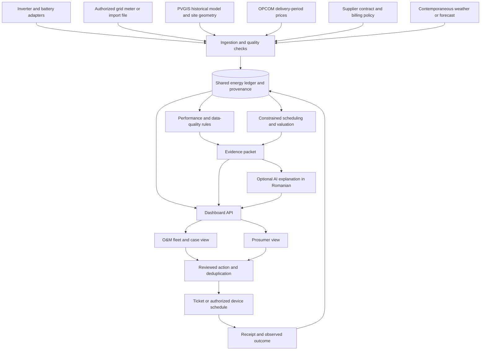

# One Energy View — dashboard architecture and concept sources

Prepared 24 October 2026 for Innovation Labs AI-Validation Bootcamp, Challenge 1.

Build one energy ledger that supports two views: **“Where did my energy go?” for the prosumer** and **“Which installations need attention?” for O&M**. Combine the useful mechanisms from winning projects behind that shared model. The first useful journey is an installation's production shortfall, its supporting evidence, an O&M ticket and a subsequent performance check.

This is a proposed architecture. The [current Python prototype](../energy_data_pipeline.py) implements only part of it. Project descriptions below come from our [winner catalogue](ONE_ENERGY_VIEW_WINNING_PROJECTS.md) and its linked submissions; adaptations are our design decisions. Awards do not establish field reliability or the right problem for Romanian customers.

## 1. Where to get each concept

Open each submission's **Story**, architecture images and **Try it out** links. Use the repository link published by the team rather than guessing a GitHub URL. Check its license before copying code; a publicly readable repository does not automatically permit reuse. Demo-first inspection is enough to borrow a workflow without importing the team's entire stack.

| Our component | Project / recorded award | What to inspect and adapt | Changes needed for One Energy View |
| --- | --- | --- | --- |
| Telemetry ingestion and live overview | [WattWise](https://devpost.com/software/hackthe6ix-bqlrik), Hack the 6ix 2024, 2nd Place | Architecture diagram; two Arduino publishers; MQTT → backend → persistent measurements → dashboard. | Replace publishers with authorized inverter and meter adapters. Normalize units and source timestamps; persist measurements before drawing charts. |
| PV, battery and power-flow channels | [PERWER](https://devpost.com/software/perwer), Africa Deep Tech Challenge 2025, IHS Power Management prize | Power/battery monitoring, connectivity and field-oriented dashboard. | Make PV, battery charge/discharge, SoC and grid exchange explicit channels. Use available device measurements; expose missing channels. |
| Connector onboarding and scheduled collection | [Soleil](https://devpost.com/software/soleil), Chainlink Fall 2021, Social Impact Prize | Site registration, validation of monitoring access, external adapters and hourly collection. | Add brand-specific authorized reads for Huawei/Fronius/Deye. Its original support is SolarEdge. Keep credentials server-side; omit tokens and financial contracts. |
| External meter access | [OpenGrid](https://ethglobal.com/showcase/opengrid-68swe), ETHGlobal New York 2025, Chainlink prize | External smart-meter retrieval and a consistent interface for other systems. | Connect an authorized meter export/gateway to the correct physical site. Avoid adding a blockchain to the MVP. |
| Geometry-aware expected generation | [SolarCulator](https://devpost.com/software/solarculator), IDEAHACK 2020, 3rd Place | Location input, JRC solar-data integration and generation estimates. | Collect GPS, capacity, tilt, orientation and inverter AC rating. Cache a baseline for that configuration. |
| O&M fleet triage | [GridVeda](https://devpost.com/software/gridveda), TreeHacks 2026, Best prototyping process | Fleet/operator interface, historical evidence and diagnostic drill-down. | Replace transformer-specific diagnostics with solar evidence. Rank persistent shortfalls and show possible explanations, coverage and uncertainty. |
| Expected-versus-actual performance | [SolarOps](https://devpost.com/software/solarops-wfjumy), GreenPioneers, 1st Place Overall | Weather integration, generation forecasting, monitoring and fault-review screens. | Join actual output to a suitable baseline and contemporaneous weather. A production deficit alone cannot establish soiling or a failed string. |
| Persistent deviation detection | [Energy Dashboard and Anomaly Detection](https://devpost.com/software/nwl-hackathon), local-authority energy hackathon, Runner up | Comparison against a site's history and similar sites with seasonal context. | Track deviations across days. Compare peers only after accounting for capacity, geometry, weather and curtailment. |
| Battery and flexible-load schedule | [Gridly](https://devpost.com/software/gridly-0h29vm), EnergyHack@GT 2026, Best Use of Vultr | Optimization engine, user deadlines, safety thresholds and hardware control. | Optimize under the customer's contract, forecast uncertainty, SoC reserve, efficiency and power limits. Show a proposal before a device command. |
| Historical savings comparison | [Better Batteries](https://devpost.com/software/challenge-1-better-batteries), HackSheffield 8, Optimise Battery Usage | Replay of customer data and comparison of battery/PV configurations. | Compare observed and alternative dispatch with the same initial and final SoC. Distinguish a hindsight benchmark from a forecast-based schedule. |
| Accessible household explanation | [WattsUp](https://devpost.com/software/wp-fn35se), EnergyHack@GT 2026, 3rd Overall; [VELObill](https://appsforenergy.devpost.com/submissions/7930-velobill-the-utility-bill-of-the-future), Apps for Energy, Third Overall | Household summary, history, costs and understandable next steps. | Use Romanian labels and kWh/RON. Explain one relevant action instead of presenting every analytic panel to the owner. |
| Checked diagnostic workflow | [kassi](https://devpost.com/software/kassi-synthetic-load-generation), Splunk Agentic Ops Hackathon 2026, Grand Prize | Audited investigation states and an inspectable sequence from telemetry to proposed remediation. | Run deterministic checks first; let AI explain the resulting evidence. Record the technician's assessment and the result after intervention. |
| Alert delivery and case history | [HawkWatch](https://devpost.com/software/hawkwatch), TreeHacks 2025, Grand Prize, as recorded locally; [Eco Fast Track](https://devpost.com/software/apartment-monitoring), HackUTD 2024, Veolia | Event → evidence → notification; property-manager and resident views. | Create a deduplicated O&M case, retain the destination receipt, assign an owner and follow it through resolution. |

**Optional later references:** [BatteryForgeAI](https://devpost.com/software/batteryforgeai) for specialist battery tools and physics-assisted analysis, and [SolarGIS](https://devpost.com/software/solargis) for shading/solar modeling. Both received honorable mentions, rather than overall first prizes. [afterimage](https://devpost.com/software/afterimage-ibp376) is a useful same-asset inspection-history pattern, but its inspected page did not establish a win.

## 2. System architecture

Use a modular Python application and a single database for the hackathon. These boxes represent responsibilities, not separate deployed microservices. Start with the existing HTML/SVG dashboard and SQLite; split services or introduce a richer frontend only when the core workflow works.



The backend performs all external collection and calculations. For example, JRC documents that PVGIS does not support browser AJAX access; fetch it server-side and serve our cached result to the dashboard. [PVGIS API documentation](https://joint-research-centre.ec.europa.eu/photovoltaic-geographical-information-system-pvgis/using-pvgis-5/api-non-interactive-service_en).

### Sources and access paths

| Source | Where to obtain it | Required treatment |
| --- | --- | --- |
| Actual inverter/BESS readings | Installer-authorized vendor API, documented local interface, or owner-provided export. [Huawei pyhfs reference](https://github.com/guillaumeblanc/pyhfs); [Fronius Solar API](https://www.fronius.com/en/help-center/solar-energy/products/monitoring-control/solutions/open-interfaces/fronius-solar-api-json-). | Capability-check the exact model and account. One worker owns each credential/session, caches reads and backs off on failures. A brand label is not a working connector. Deye access requires its own documented supported path. |
| Grid import/export | Authorized smart meter/local gateway, supplier interval export or documented meter channels exposed through the inverter. | Declare the actual origin. A meter channel returned by the same gateway is not necessarily an independent external source. Never join two unrelated households as one site. |
| Measured reference traces | [StoreNet collection](https://doi.org/10.6084/m9.figshare.c.6829134); [OPSD household data](https://data.open-power-system-data.org/household_data/). | Preserve original household, geography and period. Handle cumulative counters, resets, gaps and interpolation. Do not relabel Irish/German readings as a Romanian installation. |
| Historical expected PV | [EU JRC PVGIS API](https://joint-research-centre.ec.europa.eu/photovoltaic-geographical-information-system-pvgis/using-pvgis-5/api-non-interactive-service_en), using site geometry. | `seriescalc` supplies a historical modeled series. It is not today's weather-adjusted forecast. Keep request parameters, model period and response provenance. |
| Contemporary weather / forecast | A documented weather or irradiance feed appropriate to the installation; alternatively a measured irradiance sensor. | This connector is proposed, not already implemented. Match location and observation period; preserve forecast issue time to avoid hindsight leakage. |
| Market price | Published [OPCOM](https://www.opcom.ro/acasa/ro) data or an imported official export. | Retain source delivery intervals and currency. RON/MWh divided by 1,000 gives RON/kWh. Aggregate by interval duration, not an assumed fixed row count. |
| Applicable billing | Owner's supplier contract, tariff schedule, bills and confirmed settlement policy. | Version effective dates. OPCOM is not automatically the import or export tariff. If terms are missing, withhold a verified RON figure or show a clearly labelled scenario. |

Fronius documents local JSON reads for inverter measurements and connected components, including Smart Meters. Available channels still depend on the actual installation. [Manufacturer documentation](https://www.fronius.com/en/help-center/solar-energy/products/monitoring-control/solutions/open-interfaces/fronius-solar-api-json-).

## 3. Shared data model and joins

Use UTC interval boundaries for storage and Europe/Bucharest for display. Preserve the original source timestamp and its timezone interpretation, especially around daylight-saving changes. Keep instantaneous kW readings separate from interval kWh values.

| Entity | Minimum fields |
| --- | --- |
| `sites` | `site_id`, tenant/owner, timezone, GPS, DC kWp, AC kW rating, tilt, azimuth, battery capacity and reserve, effective configuration version |
| `sources` | `source_id`, site, connector type, available channels, last successful read, expected cadence, access state, provenance mode |
| `raw_observations` | Source ID, source timestamp, received time, original unit/payload reference, immutable content hash |
| `energy_intervals` | Site, start/end UTC, PV/load/import/export/charge/discharge kWh, SoC boundary observations, coverage and quality flags, contributing observation IDs |
| `baselines` | Site/configuration version, period, expected PV, model/weather provenance, forecast issue time where applicable |
| `prices_and_policies` | Delivery/effective period, currency, price unit, import/export valuation rule, contract version and source reference |
| `cases` | Site, event type and window, evidence version, status, severity, candidate causes, technician decision, estimated exposure and assumptions |
| `actions` | Case/schedule ID, destination, idempotency key, requested time, delivery state, destination receipt, later verification result |

Join by **physical site identity + overlapping UTC intervals + applicable configuration/policy version**. Resample only after checking what a source value means. Integrate power using time coverage; difference cumulative counters with explicit reset handling. A long gap remains missing, rather than becoming zero generation.

For AC-coupled channels measured on a consistent boundary, check the approximate balance:

```text
PV + grid import + battery discharge
    ≈ household load + grid export + battery charge + conversion losses
```

DC-coupled BESS/inverter readings may use different measurement boundaries. Document those boundaries and conversion losses before applying this check. Do not force inconsistent channels to balance by inventing load.

## 4. Dashboard screens

One application shell contains a site selector, period selector, persona switch and a visible data-mode/freshness indicator. The household sees only its authorized sites; O&M sees its assigned fleet. The same site detail and case identifiers link both views.

| Screen | Contents | Main concept sources |
| --- | --- | --- |
| **Overview / Acasă** | PV/load/BESS/grid flow, interval or daily totals, battery SoC, last update and one relevant recommendation. Label live readings separately from replayed data. | WattWise, PERWER, WattsUp |
| **Performance / Producție** | Actual and comparable expected generation; daily trend, 14-day history, weather context, missing-data bands and incident markers. | SolarOps, Energy Dashboard, SolarCulator |
| **Schedule / Baterie și consum** | Existing and proposed load/BESS schedule, reserve/deadline controls, predicted import/export and estimated difference in cost. | Gridly, Better Batteries, BYODevice |
| **Costs / Costuri** | Import cost, export value, policy period, calculation assumptions and separately labelled counterfactual opportunities. | VELObill, WattaSave, EcoVerse |
| **Fleet / Instalații** | Sites ranked by actionable evidence, persistent deviation, estimated exposure, source coverage and assigned technician. | GridVeda, PERWER, Energy Agent AI |
| **Case / Diagnostic** | Original measurements, baseline/contract references, checks performed, possible causes, inspection checklist, ticket receipt and post-intervention trend. | kassi, HawkWatch, sunfixr |
| **Connections / Conexiuni** | Access state, channels, polling cadence, last success, import provenance and configuration changes. | Soleil, OpenGrid |

Suggested overview arrangement:

```text
ONE ENERGY VIEW       Site · Period · Household / O&M · Data freshness

Production | Consumption | Battery SoC | Grid import / export
                         Energy-flow diagram

Actual vs expected production       Recommended load / battery window
Issues with supporting evidence     Costs and scenario assumptions
Maintenance cases and outcomes      Connection coverage
```

## 5. Detection, explanation and financial calculations

### Performance rules

1. Check channel availability, time alignment, freshness and coverage.
2. Establish a comparable expected series using geometry, weather and known operating constraints. If unavailable, show an exploratory difference, not a verified fault.
3. Evaluate sustained deviations over eligible daylight intervals and a rolling 14-day history. Thresholds are configurable hypotheses to calibrate with a technician, not universal engineering constants.
4. Cross-check inverter alarms, grid voltage/curtailment, meter flows, reserve SoC, battery schedules and configuration changes.
5. Create a candidate incident with the evidence and missing checks. A technician records whether it was a fault, a normal operating condition or insufficient evidence.

Use a normalized daylight residual only where expected output is meaningfully above zero:

```text
residual = (actual PV energy - comparable expected PV energy)
           / comparable expected PV energy
```

A repeating noon cap could reflect inverter sizing, an export limit, temperature or another constraint. A persistent shortfall could reflect shading, soiling, weather mismatch or a component issue. The dashboard should name the observation before suggesting a cause.

### Battery and cost engine

Minimize modeled import cost minus export compensation plus declared battery wear, subject to capacity, power, efficiency, reserve, appliance deadlines and allowed charge/discharge modes. Prevent simultaneous charge and discharge and compare alternatives at equal terminal SoC.

Keep these values separate:

- **Observed energy and billed amounts:** facts from measurements and actual billing records.
- **Estimated PV-shortfall value:** requires a defensible counterfactual and the applicable marginal energy value.
- **Estimated dispatch opportunity:** compares observed dispatch with a feasible alternative under declared assumptions.
- **Verified outcome:** later measured/reconciled evidence after an intervention.

Do not add overlapping PV-shortfall and dispatch estimates. Preserve tariffs and settlement rules as dated configuration; verify the applicable Romanian mechanism against the actual customer's documents before presenting a billing claim.

### AI boundary

The deterministic backend owns joins, arithmetic, quality gates, optimization constraints, incident identity and delivery status. An optional LLM receives a bounded evidence packet to write a Romanian explanation and proposed technician questions. Its output distinguishes observations, possible causes and missing evidence. It cannot fill missing measurements, change tariff rules, confirm a physical fault or issue arbitrary device commands.

## 6. Actions and verification

Start with an O&M ticket; device control is an optional later integration. A case follows:

```text
CANDIDATE → REVIEWED → ACTION_REQUESTED → ACTION_ACCEPTED
          → IN_PROGRESS → RESOLVED_PENDING_CHECK → VERIFIED / REOPENED
```

Use a stable incident ID for the same site, rule and continuous event; attach updated evidence to that incident rather than opening a new case for every shifted rolling window. Derive action idempotency from the incident and action type. Persist the request before sending. If a timeout leaves delivery uncertain, reconcile with the destination before retrying.

A successful HTTP response means the endpoint accepted the request, not that the installation was repaired. Keep destination case ID and technician status, then compare an appropriate post-intervention period. A device schedule additionally needs command acknowledgment and observed execution.

For an authorized lab load, a Home Assistant webhook can start an automation whose conditions are checked before actions run; automation traces provide execution evidence. Keep the endpoint private and commands bounded to the configured device. [Home Assistant trigger documentation](https://www.home-assistant.io/docs/automation/trigger/).

## 7. Proposed application boundaries

Keep these as Python modules in one backend initially:

```text
connectors/   vendor, meter, reference-file, PVGIS and price collection
normalize/    timestamps, units, counters, quality and source identity
storage/      observations, intervals, policies, cases and actions
analytics/    baselines, residuals, cross-checks and energy balance
valuation/    contract policy and transparent scenario calculations
scheduling/   feasible battery and appliance alternatives
diagnostics/  evidence packets and optional Romanian explanations
actions/      local work orders, external delivery and reconciliation
dashboard/    household, fleet and case views
```

This directory layout and the API below are proposals, not files/routes already present.

| Proposed API | Responsibility |
| --- | --- |
| `GET /sites` | Authorized sites and connection coverage |
| `GET /sites/{id}/overview` | Common-period energy totals and SoC freshness |
| `GET /sites/{id}/timeseries` | Aligned chart data, quality and provenance |
| `GET /sites/{id}/performance` | Baseline comparison and candidate incidents |
| `POST /sites/{id}/schedule-proposals` | Evaluate a constrained scenario; no device command |
| `GET /cases/{id}` | Evidence, decisions, actions and follow-up |
| `POST /cases/{id}/actions` | Request a configured action with deduplication |
| `POST /cases/{id}/assessment` | Save the technician's decision and supporting notes |

The browser receives calculations and evidence references from the backend. A refresh must not trigger a new ticket, rerun vendor login or silently replace the site's contract.

## 8. What exists in this folder and what remains to build

| Capability | Current evidence | Next step |
| --- | --- | --- |
| PVGIS historical fetch and cache | `baseline()` in [energy_data_pipeline.py](../energy_data_pipeline.py) | Extract a reusable connector and collect per-site geometry. |
| Three brand-labelled demonstration sites | `simulate()`; labels and planted faults are simulated | Replace one site with an authorized real trace or live adapter. |
| Historical load-shape and price imports | `profile()` and `prices()` | Add complete PV/BESS/meter reference-data normalization; current profile input carries load shape only. |
| Scenario valuation and dispatch comparison | `interval_cost()` and `optimize()` | Move assumptions into versioned policy records; add forecast-based operation. Current optimizer uses historical perfect information. |
| Basic site cards and production charts | `render_html()` | Add shared site drill-down, coverage and case views. |
| Local work-order creation | `serve()` with SQLite | Add assignment, assessment and outcome tracking. |
| Optional external ticket POST | `send_tickets()` with `ENERGY_TICKET_WEBHOOK` and `--send-tickets` | Configure a team-owned destination and verify destination receipts. Current records show HTTP acceptance/uncertainty; they do not prove work completion. |
| Live Huawei/Deye/Fronius adapters | Not implemented in the current script | Prove one authorized read path before adding more brands. |
| Home Assistant / BESS command delivery | Not implemented | Add only after proving telemetry quality and a bounded authorized action path. |

## 9. Build order and demo acceptance

1. **Validate the incident:** obtain an exact Romanian owner/technician quote, existing workaround, affected site and a redacted trace or access commitment.
2. **Join two independent sources:** retain site/time/source identity. Add PVGIS and the actual price/policy context with honest historical/simulated/live labels.
3. **Deliver one shared site view:** energy balance, actual/expected trend and coverage. A missing feed must visibly reduce confidence.
4. **Complete the O&M case:** evidence, reviewed candidate causes, a real local work order or configured external ticket, and a retained receipt.
5. **Demonstrate history:** show persistence, suppress duplicates and record the technician's assessment. Show a planted recovery only as simulation until real follow-up exists.
6. **Add scheduling if validated:** show a feasible alternative and its assumptions before integrating a device command.

The mentor should be able to inspect one incident end to end: **source measurements → comparable baseline → sustained deviation → supported next check → ticket → later outcome**. This proves the joins/history/action workflow; customer interviews and real incident follow-up establish whether it solves a worthwhile problem.

## 10. Supporting reading

- [Full project catalogue and award classifications](ONE_ENERGY_VIEW_WINNING_PROJECTS.md).
- [Original local winner evidence](../data/energy-research/winner-evidence.json).
- [Full Challenge 1 battleplan](../CHALLENGE_1_ENERGY_BATTLEPLAN.md).
- [Data sources and provenance](../data/energy-research/SOURCES.md).
- [Romanian prosumer problem analysis](ANALIZA_PROBLEMELOR_PROSUMATORILOR_RO.md).
- [Romanian interview questions](INTREBARI_PROSUMATORI_RO.md).
